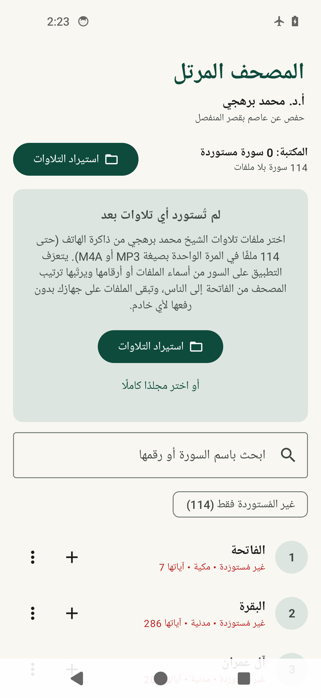

# المصحف المرتل | محمد برهجي

تطبيق أندرويد أصلي (Kotlin + Jetpack Compose) للاستماع إلى تلاوات **الأستاذ الدكتور محمد برهجي**
برواية **حفص عن عاصم بقصر المنفصل**، مستوحى من سلاسة تطبيقات البودكاست مثل Pocket Casts،
ومخصص للاستماع والتحكم فقط — دون إعلانات، ودون حسابات، ودون مزامنة سحابية، ودون أي اتصال بالإنترنت.

---

## المحتوى

- [التنزيل والتثبيت](#التنزيل-والتثبيت)
- [طريقة الاستخدام](#طريقة-الاستخدام)
- [المميزات](#المميزات)
- [الخصوصية والاستقلال عن الإنترنت](#الخصوصية-والاستقلال-عن-الإنترنت)
- [البناء من المصدر](#البناء-من-المصدر)
- [الأدلة المرئية](#الأدلة-المرئية-لقطات-حقيقية-من-محاكي-أندرويد-14-بدون-خدمات-جوجل)
- [الاختبارات: ما نُفِّذ فعليًا وما لم يُنفَّذ](#الاختبارات-ما-نفذ-فعليا-وما-لم-ينفذ)
- [البنية التقنية](#البنية-التقنية)
- [أسئلة شائعة ومشكلات متوقعة](#أسئلة-شائعة-ومشكلات-متوقعة)

---



*لقطة حقيقية من محاكي أندرويد 14 بعد إعادة تشغيل فعلية للجهاز، ووضع الطيران مفعّل: بطاقة «متابعة الاستماع» عادت بموضعها المحفوظ.*

---

## التنزيل والتثبيت

### 1) تنزيل ملف APK

- افتح صفحة **الإصدارات (Releases)** في المستودع:
  `https://github.com/mohammedalhinaki-cloud/quran-app/releases`
- نزّل أحدث إصدار، ثم حمّل الملف:
  - **`borhji-mushaf-release.apk`** ← هذا هو الملف الموصى به (موقّع وجاهز للتثبيت).
  - `borhji-mushaf-debug.apk` ← نسخة تشخيصية للاختبار فقط (اسم الحزمة مختلف، يمكن تثبيتها مع الأولى).

> يمكن تنزيل ملف APK أيضًا من تبويب **Actions** في أي تشغيل ناجح (artifacts)، لكن الإصدارات (Releases) أسهل.

### 2) التثبيت على الهاتف

1. انقل الملف إلى الهاتف أو حمّله مباشرة منه.
2. افتح الملف من مدير الملفات.
3. عند ظهور رسالة «لأمانك، هاتفك غير مسموح له بتثبيت تطبيقات مجهولة المصدر»:
   اضغط **الإعدادات** ← ثم فعّل **السماح من هذا المصدر** ← ثم ارجع واضغط **تثبيت**.

هذه الرسالة طبيعية لأي تطبيق لا يأتي من متجر Google Play، وليست مخالفة أو خطأ في التطبيق.

### 3) أجهزة Huawei بدون خدمات Google Play

التطبيق **لا يعتمد إطلاقًا** على خدمات Google Play (لا Firebase ولا Play Services ولا Google Play Billing)،
لذلك يعمل على أجهزة Huawei الحديثة (HarmonyOS / بدون GMS) بنفس الكفاءة.

### 4) المتطلبات

- **أندرويد 10 (API 29) أو أحدث.**
- مساحة تخزين كافية لملفات التلاوات (تُحسب تلقائيًا عند الاستيراد).

---

## طريقة الاستخدام

### الخطوة 1: استيراد التلاوات

1. افتح التطبيق واضغط زر **«استيراد التلاوات»**.
2. اختر إحدى الطريقتين:
   - **«اختيار ملفات التلاوات (MP3 / M4A)»**: حدّد ملفات السور (يمكنك تحديد **114 ملفًا دفعة واحدة**).
   - **«أو اختر مجلدًا كاملًا يحتوي التلاوات»**: يفحص التطبيق المجلد (ومجلداته الفرعية) ويستورد كل الملفات الصوتية.
3. يبقى خيار **«نسخ الملفات إلى مساحة التطبيق»** مفعَّلًا افتراضيًا (موصى به): ينسخ التطبيق الملفات إلى مساحته
   الخاصة فيضمن الوصول إليها دائمًا حتى بعد إعادة تشغيل الهاتف أو تغيير مكان الملفات الأصلية.
   إذا أردت توفير المساحة، أوقف هذا الخيار ليربط التطبيق الملفات من مكانها الأصلي (صلاحية دائمة عبر SAF).

**كيف يتعرّف التطبيق على السور؟** من اسم الملف أو رقمه، مثلًا:

| اسم الملف | السورة الناتجة |
|---|---|
| `001.mp3` | الفاتحة (1) |
| `002 - البقرة.mp3` | البقرة (2) |
| `سورة الكهف.mp3` | الكهف (18) |
| `002_Al-Baqarah.m4a` | البقرة (2) |
| `تبارك.mp3` | الملك (67) |
| `محمد برهجي - 036 - يس.mp3` | يس (36) |
| `الحجرات.mp3` | الحجرات (49) — وليست الحج (22) |
| `An-Nas 114.mp3` | الناس (114) |

ثم تُرتَّب السور **ترتيب المصحف الصحيح** (من الفاتحة إلى الناس) وليس ترتيبًا أبجديًا،
وتظهر السور الناقصة داخل القائمة بشكل واضح («غير مُستورَدة») مع إمكانية **تعيين ملفها يدويًا**
من قائمة السور ← «تعيين ملف»، أو من نتيجة الاستيراد عند وجود ملف لم يُتعرَّف عليه.

### الخطوة 2: الاستماع

- اضغط أي سورة لتبدأ من الموضع المحفوظ لها (إن وُجد).
- زر **«متابعة الاستماع»** في الأعلى يعيدك لآخر سورة استمعت إليها من حيث توقفت بالضبط.
- المشغل المصغّر يبقى أسفل الشاشة أثناء التنقل في القائمة، والضغط عليه يفتح **المشغل الموسّع**:

| الأداة | الوظيفة |
|---|---|
| شريط التقدم | الانتقال إلى أي موضع من التلاوة |
| ⏪ / ⏩ | تأخير/تقديم 10 ثوانٍ |
| السابق/التالي | الانتقال بين السور المتوفرة (يتخطى السور غير المستوردة) |
| سرعة التشغيل | 0.75x إلى 2.0x والافتراضية **1.0x** |
| تكرار السورة | إعادة السورة الحالية تلقائيًا |

- **التشغيل التلقائي للسورة التالية** يعمل بعد انتهاء السورة الحالية.
- **لا يبدأ التشغيل تلقائيًا** عند فتح التطبيق — الاستئناف يحدث فقط بضغطك على زر التشغيل.

### الخطوة 3: المتابعة لاحقًا

التطبيق يحفظ تلقائيًا:

- **آخر سورة** استمعت إليها.
- **موضع الاستماع بالدقيقة والثانية وبدقة المللي ثانية** — مستقل لكل سورة على حدة.
- **سرعة التشغيل** المختارة و**وضع التكرار**.

الحفظ يجري **كل 3 ثوانٍ أثناء التشغيل**، وفورًا عند: الإيقاف المؤقت، تحريك شريط التقدم،
تغيير السورة، إيقاف المشغل، وكذلك **داخل خدمة التشغيل** في الخلفية (فلا يضيع الموضع حتى لو أُغلقت الواجهة).

### التشغيل في الخلفية

- يستمر الصوت عند **إطفاء الشاشة وقفل الهاتف**.
- يستمر الصوت عند **الانتقال إلى تطبيق آخر** أو الرجوع للشاشة الرئيسية.
- يستمر الصوت عند **إزالة واجهة التطبيق من التطبيقات الأخيرة** (طالما النظام يسمح باستمرار خدمة التشغيل).
- **إشعار التشغيل** في شريط الإشعارات وشاشة القفل: اسم السورة وأزرار تشغيل/إيقاف/السابق/التالي.
- **أزرار السماعات السلكية والبلوتوث** تعمل (تشغيل/إيقاف/التالي/السابق).
- عند ورود **مكالمة أو فقدان التركيز الصوتي** يتوقف الصوت مؤقتًا، ويستكمل بشكل صحيح عند عودته.

> ملاحظة تقنية صريحة: المقصود استمرار الصوت عند قفل الشاشة أو إغلاق الواجهة، وليس عند إيقاف طاقة الهاتف
> بالكامل (إطفاء الجهاز) لأن التشغيل حينها مستحيل تقنيًا لأي تطبيق.

---

## المميزات

- **مشغل احترافي مبني على AndroidX Media3 (ExoPlayer)** مع خدمة أمامية `mediaPlayback` وجلسة وسائط كاملة.
- **حفظ دقيق لموضع الاستماع** لكل سورة (Room + DataStore) مع بطاقة «متابعة الاستماع».
- **استيراد مرن** عبر Storage Access Framework: ملفات متعددة أو مجلد كامل، مع صلاحيات دائمة أو نسخ آمن.
- **ترتيب المصحف الصحيح** لكل السور الـ114 مع أسمائها وأرقامها وعدد آياتها ونوعها (مكية/مدنية).
- **تعيين يدوي** لأي سورة عند فشل التعرف التلقائي، وإظهار السور غير المستوردة بوضوح.
- **واجهة عربية بالكامل مع دعم RTL**، تصميم هادئ، أزرار كبيرة، ومتجاوب مع مختلف المقاسات، مع الوضع الليلي.
- **بحث فوري** عن السور بالاسم أو الرقم، وفلتر «غير المُستوردة فقط».
- **معالجة أخطاء**: إذا كان ملف مفقودًا أو تالفًا لا ينهار التطبيق؛ يتخطى الملف ويعرض تنبيهًا مع إمكانية التعيين.
- **بدون إعلانات، بدون حسابات، بدون تسجيل دخول، بدون مزامنة سحابية.**

---

## الخصوصية والاستقلال عن الإنترنت

- التطبيق **لا يطلب صلاحية الإنترنت أصلًا**، بل يزيلها من ملف التطبيق النهائي
  (`tools:node="remove"` في `AndroidManifest.xml`)، ويمكنك التحقق من ذلك بنفسك:
  الإعدادات ← التطبيقات ← المصحف المرتل ← الأذونات (لن تجد أي إذن شبكة).
- **لا يُرفع أي ملف صوتي إلى أي خادم**، وكل شيء (الملفات، المواضع، الإعدادات) يبقى على جهازك.
- لا توجد أي مكتبة تحليلات أو تتبع أو إعلانات.

---

## البناء من المصدر

### أ) عبر GitHub Actions (بدون تثبيت أي شيء على جهازك)

1. ارفع المشروع إلى مستودع GitHub (يمكن تركه خاصًا).
2. سيفتح عملان تلقائيًا عند أي دفع:
   - **Build APK**: يشغّل اختبارات الوحدة، ويبني نسختي debug و release، وينشر إصدارًا جديدًا يحتوي ملف APK.
   - **Instrumented Tests (Emulator)**: يشغّل اختبارات حقيقية على محاكي أندرويد (بدون خدمات Google).
3. من تبويب **Actions** يمكنك متابعة التنفيذ، ومن تبويب **Releases** تنزيل الـAPK.

المفتاح المستخدم للتوقيع موجود في `keystore/borhji-release.p12` (كلمة المرور في `keystore/keystore.properties`).
يمكنك استبداله بمفتاحك الخاص، أو تمرير قيم جديدة عبر المتغيرات:
`SIGNING_STORE_FILE`, `SIGNING_STORE_PASSWORD`, `SIGNING_KEY_ALIAS`, `SIGNING_KEY_PASSWORD`.

### ب) على جهاز الحاسوب (Android Studio أو سطر الأوامر)

```bash
git clone <رابط-المستودع>
cd quran-app
./gradlew :app:assembleDebug      # نسخة تشخيصية
./gradlew :app:assembleRelease    # نسخة موقّعة (تحتاج keystore/keystore.properties)
./gradlew :app:testDebugUnitTest  # اختبارات الوحدة
```

المتطلبات: JDK 17، Android SDK (compileSdk 35, build-tools 35.0.0). لا حاجة لـ Google Play Services.

---

## الأدلة المرئية (لقطات حقيقية من محاكي أندرويد 14 بدون خدمات جوجل)

كل اللقطات التالية التُقطت **آليًا داخل عملية التطبيق أثناء تشغيل فعلي لملف صوتي حقيقي**،
ومع **تفعيل وضع الطيران** (لا إنترنت إطلاقًا)، ثم حُفظت في المستودع داخل مجلد `screenshots/`:

| اللقطة | ما تُثبته |
|---|---|
| `screenshots/01-home-playing.png` | الشاشة الرئيسية: «المصحف المرتل»، «أ.د. محمد برهجي»، «حفص عن عاصم بقصر المنفصل»، بطاقة «متابعة الاستماع»، زر «استيراد التلاوات»، البحث، قائمة السور بترتيب المصحف، مؤشر السورة المُشغَّلة، والمشغل المصغّر أسفل الشاشة مع شريط التقدم |
| `screenshots/02-player-expanded.png` | المشغل الموسّع: شريط تقدم تفاعلي، الزمن المنقضي/المتبقي، أزرار ±10 ثوانٍ، السابق/التالي، خيارات السرعة (1.0x هي الافتراضية)، تكرار السورة، إيقاف وإخفاء المشغل |
| `screenshots/03-notification-shade.png` | **إشعار التشغيل الحقيقي** في لوحة الإشعارات: اسم السورة «البقرة»، اسم القارئ، شريط التقدم، وزر الإيقاف المؤقت — (الإشعار يظهر على شاشة القفل أيضًا لأنه إشعار وسائط) |
| `screenshots/04-home-after-reboot.png` | **بعد `adb reboot` حقيقي**: عادت بطاقة «متابعة الاستماع → سورة البقرة — الموضع المحفوظ 00:12» كما هي، مع بقاء الملفات المستوردة — ووضع الطيران مفعّل |

---

## الاختبارات: ما نُفِّذ فعليًا وما لم يُنفَّذ

> مبدأ صريح: لا ندّعي نجاح أي اختبار لم يُنفَّذ فعليًا، ولا وجود ملف APK لم يُبنَ.

### 1) اختبارات الوحدة — تُشغَّل تلقائيًا على كل دفع ✅

| الملف | التغطية |
|---|---|
| `SurahResolverTest` | أكثر من 30 حالة لتعرّف أسماء الملفات: الأرقام، الأسماء العربية، الأسماء البديلة، الأسماء اللاتينية، والتشابه الذي يسبب أخطاء (الحج/الحجرات، الحجر/النور…) |
| `SurahDataTest` | 114 سورة، الترتيب 1→114، الأسماء وعدد الآيات مكية/مدنية |
| `ProgressMathTest` | استرجاع الموضع بدقة المللي ثانية (47:35 مثالًا)، تصفير نهاية السورة، استقلال الموضع لكل سورة، تنسيق الأوقات والسرعات |

النتيجة الفعلية: **33 اختبارًا، كلها ناجحة** (آخر تشغيل ناجح موثّق في CI).

### 2) اختبارات حقيقية على محاكي أندرويد (Instrumented) ✅

تُنفَّذ على **Android 14 (API 34) بلا خدمات Google**، مع **وضع الطيران مفعّلًا**، وتشمل إعادة تشغيل حقيقية للجهاز.
آخر تشغيل ناجح: **16 اختبارًا، كلها ناجحة** — 11 في المرحلة الأولى + 1 لالتقاط اللقطات + 1 لتجهيز حالة الاستئناف + 3 بعد إعادة التشغيل:

| الاختبار | ما تحقّق فعليًا |
|---|---|
| `LibraryImportTest` (4) | كتابة ملفات صوتية حقيقية بأسماء ملفات واقعية → استيرادها فعليًا → ربط كل ملف بالسورة الصحيحة، ترتيب المصحف، نسخ الملفات وقراءتها، حساب المدة الحقيقية، إظهار السور الناقصة، التعيين اليدوي لملف غير معروف، واستقلال الموضع المحفوظ لكل سورة |
| `PlaybackTest` (5) | تشغيل فعلي عبر Media3/ExoPlayer والتحقق من **تقدّم الموضع**؛ الانتقال إلى موضع محدد وحفظه؛ **استمرار الصوت بعد الانتقال لتطبيق آخر**؛ **استمرار الصوت بعد إزالة الواجهة من التطبيقات الأخيرة** (`finishAndRemoveTask`) مع استمرار تقدّم الموضع وحفظه؛ **ظهور إشعار التشغيل باسم السورة «البقرة» مع أزرار التحكم** (تحقق فعلي من خدمة الإشعارات: `NOTIFICATION_TITLE=البقرة ACTIONS=2` وظهوره على الشاشة)؛ الإيقاف مع بقاء الموضع المحفوظ |
| `UiSmokeTest` (2) | الشاشة الرئيسية: العنوان، اسم القارئ، الرواية، زر الاستيراد، البحث، ظهور السور المستوردة، وحالة «لا توجد تلاوات» |
| `RebootPrepareTest` (1) | تشغيل حقيقي → انتقال إلى الموضع 00:12 → حفظ فوري (تحقق: `PREPARED_DB_POSITION_MS=12000` و`PREPARED_SESSION_POSITION_MS=12000`) **قبل** إعادة التشغيل |
| `RebootPersistenceTest` (3) | **بعد `adb reboot` حقيقي**: بقاء ملفات التلاوات مقروءة، بقاء الموضع المحفوظ في قاعدة البيانات وفي إعدادات الجلسة، وظهور بطاقة «متابعة الاستماع» بالاسم والموضع الصحيحين |
| `ScreenshotTest` (1) | التقاط اللقطات أعلاه داخل التطبيق أثناء التشغيل، مع تحقق فعلي من فتح المشغل الموسّع بالضغط على المشغل المصغّر |

### 3) ما لم يُختبر بعد (بصراحة تامة)

- **أزرار السماعات السلكية والبلوتوث**: الكود يعتمد واجهات Media3 القياسية (`MediaSession` + `MediaButtonReceiver` + معالجة التركيز الصوتي)،
  ولم تُختبر على أجهزة بلوتوث/سماعات حقيقية.
- **المكالمات الهاتفية الفعلية**: التقاط التركيز الصوتي سلوك قياسي مُفعَّل (`setAudioAttributes(..., handleAudioFocus = true)`)،
  ولم تُجرَّب مكالمة حقيقية أثناء التشغيل.
- **ملفات MP3/M4A الحقيقية من مكتبة الشيخ**: الاختبارات استخدمت ملفات صوتية حقيقية مُنشأة على الجهاز (WAV) لتشغيل محرّك ExoPlayer فعليًا.
  مكتبة Media3 تدعم MP3 و M4A/AAC و OGG و FLAC أصلًا، لكن **لم يُختبَر ملف MP3 فعلي من ملفاتك**.
- **نافذة اختيار الملفات (SAF) نفسها**: لا يمكن أتمتة النقر على واجهة نظام أندرويد في CI. المسار المُختبَر هو **منطق الاستيراد الكامل**
  بملفات حقيقية على الجهاز، أما نافذة الاختيار فهي واجهة نظام قياسية.
- **سلوك الشركة المصنّعة (Huawei/Xiaomi…) في قتل الخدمات في الخلفية**: بعض الأنظمة تُشدّد على الخدمات،
  وقد تحتاج إضافة التطبيق إلى قائمة «التطبيقات المحمية/عدم تحسين البطارية».
- **التشغيل عند إطفاء الهاتف تمامًا**: مستحيل تقنيًا لأي تطبيق (المقصود عند قفل الشاشة/إغلاق الواجهة، وقد تم إثباته).

---

## البنية التقنية

```
app/src/main/java/com/borhji/mushaf/
├── MainActivity.kt                 # نقطة الدخول (Compose)
├── MushafApp.kt                    # Application + قناة الإشعار
├── data/
│   ├── SurahData.kt                # السور الـ114: الاسم، اللاتيني، مكية/مدنية، عدد الآيات، الأسماء البديلة
│   ├── Models.kt                   # نماذج البيانات (المكتبة، الاستيراد، الحالة)
│   ├── MushafDatabase.kt           # Room: ملفات التلاوات + مواضع الاستماع
│   ├── SettingsRepository.kt       # DataStore: آخر سورة/موضع، السرعة، التكرار
│   ├── ProgressRecorder.kt         # حفظ الموضع (دوري + فوري)
│   ├── AudioImporter.kt            # قراءة الملفات، النسخ، المدد، فحص المجلدات (SAF)
│   ├── LibraryRepository.kt        # مصدر الحقيقة للمكتبة (استيراد/تعيين/حذف/توفّر)
│   └── importer/
│       ├── ArabicText.kt           # توحيد النص العربي والأرقام
│       └── SurahResolver.kt        # التعرف الذكي على السورة من اسم الملف
├── playback/
│   ├── QuranPlaybackService.kt     # MediaSessionService + ExoPlayer + حفظ الموضع في الخلفية
│   ├── PlaybackController.kt       # واجهة التحكم من الواجهة (MediaController)
│   └── PlayerState.kt              # حالة المشغل وثوابته
├── ui/
│   ├── MushafRoot.kt               # الجذر (RTL، الأوراق، الأذونات)
│   ├── HomeScreen.kt               # الشاشة الرئيسية (الترويسة، المتابعة، القائمة، البحث)
│   ├── PlayerComponents.kt         # المشغل المصغّر والموسّع ومؤشر التشغيل
│   ├── ImportSheet.kt              # ورقة الاستيراد وملخص النتائج
│   ├── SurahPickerDialog.kt        # اختيار السورة يدويًا
│   ├── MainViewModel.kt            # حالة الواجهة ومنطق الأوامر
│   └── theme/Theme.kt              # الألوان والثيم (فاتح/داكن)
└── util/
    ├── ProgressMath.kt             # حسابات الموضع والاستئناف (منطق نقي قابل للاختبار)
    └── TimeFormat.kt               # تنسيق الأوقات والسرعات
```

**الاعتماديات الأساسية**: Kotlin 2.0، Jetpack Compose (Material 3)، AndroidX Media3 1.4.1 (ExoPlayer + Session)،
Room 2.6، DataStore Preferences، Coroutines. الحد الأدنى: أندرويد 10 (API 29)، والهدف: API 34.

---

## أسئلة شائعة ومشكلات متوقعة

**س: لم يتعرّف التطبيق على سورة معينة، ماذا أفعل؟**
ج: افتح القائمة ← اضغط زر **+** بجانب السورة (أو «⋯» ← «تعيين ملف») ← اختر الملف الصحيح.
سيُحفظ التعيين نهائيًا.

**س: ظهرت رسالة «المساحة غير كافية»؟**
ج: أوقف خيار «نسخ الملفات إلى مساحة التطبيق» في ورقة الاستيراد، أو أفرِغ مساحة ثم أعد الاستيراد.

**س: هل سأحتاج إعادة الاستيراد بعد إعادة تشغيل الهاتف؟**
ج: لا. الملفات إما منسوخة داخل التطبيق، وإما مرتبطة بصلاحية وصول دائمة (Persistable URI Permission)،
ويبقى الاستيراد والمواضع محفوظة.

**س: الصوت يتوقف بعد فترة على هاتف Huawei/Xiaomi؟**
ج: فعّل «تشغيل بلا قيود/إدارة البطارية يدويًا» للتطبيق من إعدادات الجهاز، لأنه نظام الشركة المصنّعة
يقيّد الخدمات في الخلفية.

**س: كيف أتحقق أن التطبيق لا يتصل بالإنترنت؟**
ج: الإعدادات ← التطبيقات ← المصحف المرتل ← الأذونات: لا يوجد أي إذن شبكة (لا Internet ولا Network State
المتعلق بالاتصال)، ويمكن التحقق من داخل ملف APK نفسه.

---

## الترخيص والحقوق

- **التلاوات**: حقوقها لصاحبها **الأستاذ الدكتور محمد برهجي**، والتطبيق لا يتضمّن أي ملف صوتي —
  بل يستورد المستخدم ملفاته الخاصة من جهازه. لا يُوزَّع أي صوت مع التطبيق.
- **الشيفرة البرمجية**: مشروع خاص لصاحب المستودع، ويُستخدم كما هو.
